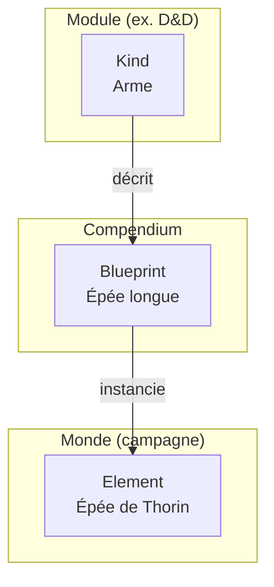
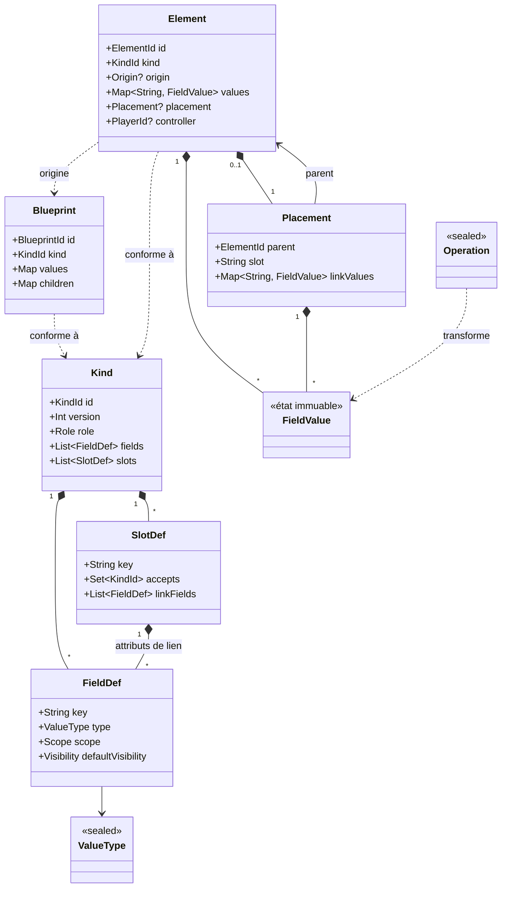
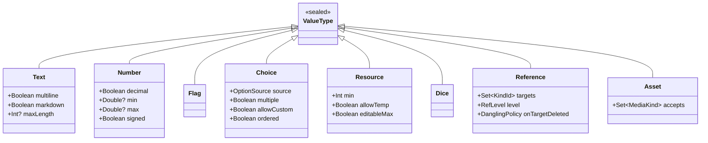
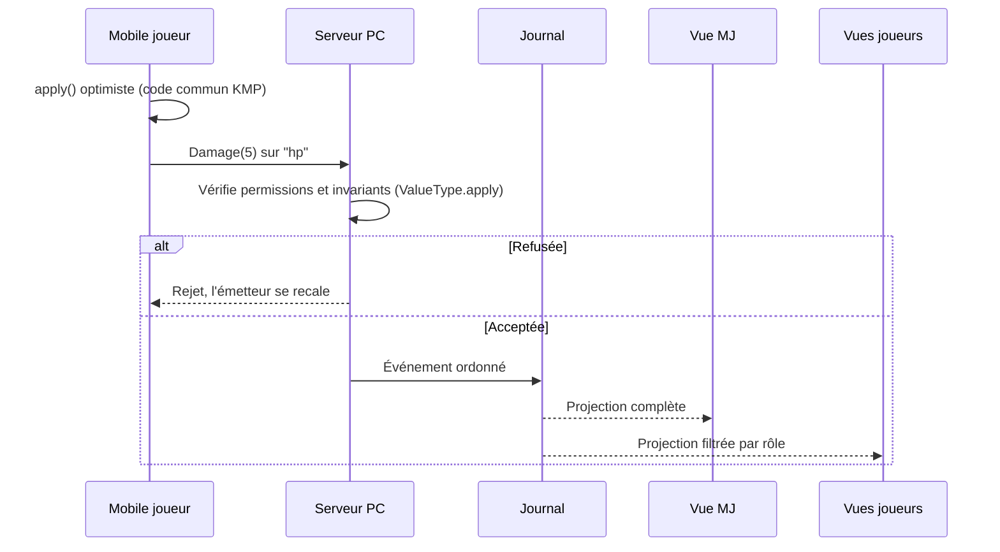
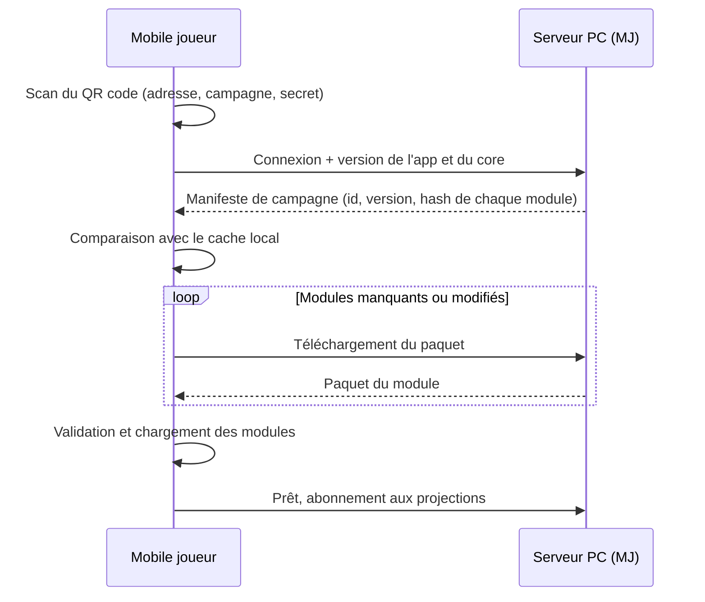

# Jdr Assistant — Conception du core

> Document de travail. Il distingue trois statuts :
> **Décidé** (validé explicitement), **Proposé** (piste retenue en discussion, à confirmer) et **Ouvert** (question non tranchée).

## 1. Objectif du core

Le core fournit un modèle générique capable de représenter les fiches, objets, sorts, capacités, etc. de n'importe quel système de JdR, sans embarquer de règles. Les systèmes (D&D en premier) sont apportés par des **modules déclaratifs**.

Le core ne calcule rien à la place du MJ : il stocke, valide la structure des données, synchronise et affiche.

N'importe qui peut créer un module pour son système de jeu, à la manière des systèmes Foundry VTT, sans logique de calcul.

## 2. Décisions

| # | Sujet | Statut | Décision |
|---|-------|--------|----------|
| D1 | Définition / instance | **Décidé** | Une définition est un squelette réutilisable (ex. « Épée longue »). Une instance est une copie dotée d'un cycle de vie (ex. l'épée de Thorin). |
| D2 | Composition | **Décidé** | Un élément porte des valeurs et peut contenir des sous-éléments. Un objet peut vivre seul ou à l'intérieur d'un autre élément. |
| D3 | Valeurs riches | **Décidé** | Les valeurs sont des modèles objet. Le core définit les types de valeurs, qui portent leur fonctionnement (opérations, invariants) et leur état. |
| D4 | Element dans le core | **Décidé** | `Element` est une classe générique du core. |
| D5 | Modules déclaratifs | **Décidé** | Un type comme « PJ » est une **déclaration** du module (données), pas une sous-classe Kotlin. Les modules ne contiennent pas de code compilé. |
| D6 | Modules tiers | **Décidé** | N'importe qui peut créer un module de système de jeu (ex. Pathfinder) : schémas, types de personnages, d'objets, de compétences, bibliothèque de contenus **et interfaces** (layout, style, boutons et leurs actions). Le core interprète le module, côté MJ comme côté mobile. |
| D7 | Modèle de référence | **Décidé** | Inspiré des systèmes Foundry VTT, en moins poussé : pas de logique de calcul ni d'automatisation. |
| P7 | UI déclarative riche | Proposé | L'interface d'un module est décrite en données (layout, tokens de style, actions = listes d'opérations, conditions d'affichage, entrées utilisateur). Le core maintient le **vocabulaire**, pas les écrans des modules. |
| P8 | Distribution | Proposé | Les modules sont téléchargés par le mobile **depuis le serveur PC du MJ** en rejoignant la campagne, sans passer par un store. |
| P9 | Système / extension | Proposé | Un *système* définit Kinds, layouts et thème ; une *extension* (bestiaire, homebrew) ajoute du contenu et dépend d'un système. |
| P1 | Trois niveaux | Proposé | Type (`Kind`, fourni par le module) → définition (`Blueprint`, compendium) → instance (`Element`, monde). |
| P2 | Modèle unifié | Proposé | Une seule structure (`Element`) ; la distinction « Actor / Item » est un **rôle** porté par le `Kind`, pas deux modèles distincts. |
| P3 | Slots et attributs de lien | Proposé | Les enfants sont rangés dans des slots typés (inventaire, sorts, capacités…). Les attributs de la relation (équipé, préparé, quantité) sont portés par le `Placement`, pas par l'objet. |
| P4 | Opérations typées | Proposé | Toute modification passe par une opération sémantique (`Damage(5)` plutôt que `Set(12)`), validée et ordonnée par le serveur PC, puis journalisée. |
| P5 | Projections | Proposé | Chaque client reçoit une vue de l'état filtrée par son rôle (asymétrie MJ / joueurs). |
| P6 | Pas de valeurs dérivées | Proposé | Pas de type « formule » : il imposerait un langage d'expressions, porte d'entrée d'un moteur de règles. |

## 3. Vocabulaire (noms provisoires)

| Terme | Rôle | Où |
|-------|------|----|
| `Kind` | Schéma d'un type : rôle, champs, slots | Déclaré par un module |
| `FieldDef` | Déclaration d'un champ : clé, `ValueType` + configuration, scope | Dans un `Kind` |
| `SlotDef` | Collection d'enfants typés + attributs de lien | Dans un `Kind` |
| `ValueType` | Type de valeur : configuration, état, opérations | Core |
| `FieldValue` | État d'un champ dans une instance | Core |
| `Blueprint` | Définition réutilisable | Compendium (module ou homebrew MJ) |
| `Element` | Instance vivante | Monde / campagne |
| `Placement` | Lien parent → enfant dans un slot | Monde / campagne |
| `Operation` | Commande typée modifiant une valeur ou la structure | Core |

> Les noms `Kind`, `Blueprint` et `Element` restent ouverts au débat (alternatives évoquées : `Archetype`, `Prototype`, `Template`, `Document`, `Actor` / `Item`).

## 4. Les trois niveaux



Les trois niveaux ont des cycles de vie différents :

- **Kind** : livré et versionné avec le module, évolue rarement ;
- **Blueprint** : donnée éditable (compendium du module ou homebrew du MJ) ;
- **Element** : état vivant, modifié en permanence pendant la session.

## 5. Répartition du code

```mermaid
flowchart LR
    subgraph Core["Core (Kotlin, commonMain)"]
        direction TB
        Kind
        FieldDef["FieldDef / SlotDef"]
        ValueType
        FieldValue
        Blueprint
        Element
        Placement
        Operation
    end
    subgraph DnD["Module D&D (déclaratif)"]
        direction TB
        KPJ["Kind PJ"]
        KPNJ["Kind PNJ"]
        KArme["Kind Arme"]
        KSort["Kind Sort"]
        SRD["Blueprints SRD"]
        Layouts["Layouts de fiche"]
    end
    subgraph Apps["Apps KMP (PC et mobile)"]
        direction TB
        Serveur["Serveur + journal"]
        Rendu["Rendu générique"]
        Chargeur["Chargeur de modules"]
    end
    DnD -- "utilise les types du core" --> Core
    Core --> Apps
```



- **Core** : code Kotlin écrit une seule fois.
- **Module** : données exprimées avec les types du core, téléchargeables depuis le serveur du MJ (contrainte iOS et politiques des stores : pas de code compilé téléchargé). Peut être écrit par un tiers (voir section 9).
- **Apps** : ne connaissent que le core. Elles affichent une fiche PJ sans savoir ce qu'est un PJ, en lisant les `FieldDef`, `SlotDef` et layouts du module.

Exemple de déclaration côté module (le DSL n'est qu'un outil d'écriture, le résultat est sérialisé) :

```kotlin
val weapon = kind("dnd5e:weapon", role = Role.ITEM) {
    field("damage", Dice, scope = INTRINSIC)
    field("properties", Text(), scope = INTRINSIC)
}

val playerCharacter = kind("dnd5e:pc", role = Role.ACTOR) {
    field("hp", Resource(allowTemp = true), scope = STATE)
    group("abilities") {
        listOf("str", "dex", "con", "int", "wis", "cha")
            .forEach { field(it, Number(min = 1.0, max = 30.0)) }
    }
    slot("inventory", accepts = setOf(weapon)) {
        link("equipped", Flag)
        link("quantity", Number(min = 1.0))
    }
}
```

Une façade typée optionnelle reste possible pour un module embarqué (tests, écran spécifique), sans changer le modèle :

```kotlin
@JvmInline
value class PlayerCharacter(val element: Element) {
    val hp get() = element.resource("hp")
}
```

## 6. Modèle de classes du core



Notes :

- **Scope d'un champ** : `INTRINSIC` (vient de la définition : dégâts, description) ou `STATE` (n'existe que dans l'instance : charges restantes, PV actuels).
- **Composition vs référence** : un sac *contient* une corde (composition, un seul parent, via `Placement`) ; un parchemin *référence* un sort (type de valeur `Reference`).
- **Objet libre** : un `Element` sans `Placement`, ou placé dans un Element « Lieu » / « Réserve ».
- **Empilement** : 50 flèches = une instance avec une quantité, nécessitant des opérations `Split` / `Merge`.

## 7. Types de valeurs

Chaque `ValueType` se décompose en trois parties :

- **configuration** : déclarée dans le `FieldDef` par le module (bornes, options, multiplicité…) ;
- **état** : porté par l'instance, immuable (chaque opération produit un nouvel état) ;
- **opérations** : seules façons légitimes de faire évoluer l'état ; elles garantissent les invariants.

```kotlin
interface ValueTypeBehavior<C : Any, S : Any, O : Any> {
    fun initial(config: C): S
    fun apply(state: S, op: O, config: C): Result<S>
}
```

L'ensemble des types est **fermé** (hiérarchie scellée dans le core) : un module compose des types connus, ce qui permet au mobile d'afficher n'importe quel module sans code supplémentaire.

### Catalogue

| Type | Statut | Configuration envisagée | Exemples D&D |
|------|--------|-------------------------|--------------|
| `Text` | **Décidé** | `multiline`, `markdown`, `maxLength` | Nom, notes, description de sort |
| `Number` | **Décidé** | entier / décimal, bornes, affichage signé | Caractéristiques, CA, poids |
| `Flag` (booléen) | **Décidé** | — | Inspiration, harmonisé |
| `Choice` | **Décidé** | source des options, `multiple`, `allowCustom`, `ordered` | Alignement, langues, maîtrise (aucune / demi / maîtrise / expertise) |
| `Resource` | **Décidé** | `min`, max, temporaire, reset | PV, emplacements de sorts, charges, jets contre la mort |
| `Dice` | Proposé | — | Dégâts, dés de vie |
| `Reference` | Proposé | cibles (Kinds), niveau (Blueprint / Element), politique si cible supprimée | Parchemin → sort, familier → maître |
| `Asset` | Proposé | types de média acceptés | Portrait, jeton, illustration |



Exemple d'opérations pour `Resource` :

```kotlin
data class ResourceState(val current: Int, val max: Int, val temp: Int = 0)

sealed interface ResourceOp {
    data class Damage(val amount: Int) : ResourceOp  // consomme temp puis current
    data class Heal(val amount: Int) : ResourceOp    // plafonné à max
    data class SetTemp(val amount: Int) : ResourceOp
    data class SetMax(val max: Int) : ResourceOp
    data object Reset : ResourceOp                    // repos
}
```

### Ce qui n'est pas un type (proposé)

- **Cases à cocher / pastilles** : une `Resource` à petit max ; l'affichage relève du layout.
- **Texte riche** : configuration de `Text`.
- **Groupe** (caractéristiques, monnaie) : regroupement de champs dans le `Kind`, pas un type de valeur — la synchronisation reste au niveau du champ.
- **Valeur dérivée / formule** : exclue (voir P6).

### Frontière avec les règles

Le comportement **structurel** d'un type vit dans le core (les PV ne descendent pas sous le minimum, les dégâts consomment d'abord le temporaire). Les **règles du système** n'y vivent pas (une résistance divise les dégâts par deux) : elles restent l'affaire du MJ.

## 8. Flux d'une opération (proposé)



Apports attendus :

- **Commutativité** : deux `Damage` concurrents se composent ; deux `Set` s'écrasent.
- **Historique** lisible (« Thorin : −5 PV par le MJ »), undo, rejeu à la reconnexion.
- **Application optimiste** côté mobile avec la même fonction pure que le serveur.

## 9. Modules de système de jeu

### 9.1 Principe

Un module est un **paquet de données** interprété par le core. Il contient tout ce qui est propre à un système de jeu, interface comprise. Le core fournit un vocabulaire fermé (types de valeurs, primitives de layout, widgets, opérations, tokens de style) ; les auteurs de modules composent avec.

Pourquoi pas de code dans les modules :

- une fonction `@Composable` est du code compilé, elle ne peut pas être transmise comme donnée ;
- iOS interdit l'exécution de code natif téléchargé, et les stores encadrent strictement le code téléchargé ;
- un module venant d'un tiers s'exécute sur le téléphone de chaque joueur : un module déclaratif est **sûr par construction**.

Le principe « pas de règles » rend cette approche réaliste : ce qui exigerait du vrai code (valeurs dérivées, automatisation, résolution d'effets) est hors périmètre.

### 9.2 Correspondance avec Foundry VTT

| Foundry VTT | Jdr Assistant | Remarque |
|---|---|---|
| `system.json` (manifeste) | `module.json` | id, version, compatibilité core, dépendances |
| `template.json` / DataModels | `kinds/*.json` | Kinds avec FieldDef et SlotDef |
| Compendium packs | `compendium/*.json` | Blueprints (armes, sorts, monstres…) |
| Templates Handlebars | `layouts/*.json` | Arbres de `LayoutNode` |
| CSS | `theme.json` + `assets/` | Tokens, variantes, polices, icônes |
| `lang/*.json` | `i18n/*.json` | Libellés traduisibles |
| JS : logique de fiche | `actions` dans les layouts | Listes d'opérations déclaratives |
| JS : calculs, automatisation | — | Exclus par principe |

### 9.3 Structure d'un paquet (proposé)

```
pf2e/
├── module.json
├── kinds/
│   ├── character.json
│   ├── npc.json
│   ├── weapon.json
│   ├── spell.json
│   └── feat.json
├── compendium/
│   ├── weapons.json
│   ├── spells.json
│   └── ancestries.json
├── layouts/
│   ├── character.sheet.json
│   ├── weapon.compact.json
│   └── weapon.detail.json
├── theme.json
├── i18n/
│   ├── fr.json
│   └── en.json
└── assets/
    ├── fonts/
    └── icons/
```

Manifeste d'un système :

```json
{
  "id": "pf2e",
  "type": "system",
  "title": "Pathfinder 2e",
  "version": "1.2.0",
  "authors": ["…"],
  "compatibility": { "core": { "minimum": "1.0", "verified": "1.3" } },
  "languages": ["fr", "en"],
  "dependencies": []
}
```

Manifeste d'une extension (homebrew d'une table) :

```json
{
  "id": "homebrew-table-jeudi",
  "type": "extension",
  "title": "Homebrew de la table du jeudi",
  "version": "0.3.0",
  "compatibility": { "core": { "minimum": "1.0" } },
  "dependencies": [{ "id": "pf2e", "version": ">=1.2" }]
}
```

### 9.4 Interface déclarative (proposé)

L'interface d'un module combine :

- **Layout** : arbre de `LayoutNode` (colonne, ligne, grille, onglets, section, champ, liste d'un slot, libellé…) ;
- **Style** : tokens de thème (couleurs, typographies, arrondis), variantes de composants, assets ;
- **Actions** : listes d'opérations paramétrées, déclenchées par un bouton ;
- **Conditions** : affichage conditionnel (« si `isSpellcaster` ») ;
- **Entrées** : saisie utilisateur réinjectée dans une opération (« demander n, puis `Damage(n)` ») ;
- **Indices d'affichage** (`DisplayHint`) : une `Resource` en barre ou en pastilles, etc.

Chaque Kind d'Item peut fournir plusieurs layouts (`compact` pour une liste, `detail` pour une vue complète).

```json
{
  "type": "Button",
  "label": "Repos long",
  "style": "primary",
  "confirm": "Effectuer un repos long ?",
  "actions": [
    { "op": "Resource.Reset", "field": "hp" },
    { "op": "Resource.Reset", "field": "spellSlots.*" },
    { "op": "Resource.Recover", "field": "hitDice", "fraction": 0.5 },
    { "op": "Notify", "to": "gm", "message": "{name} prend un repos long" }
  ]
}
```

Côté app, un **interpréteur unique** en Compose Multiplatform (PC MJ et mobile) transforme ces descriptions en composables :

```kotlin
@Serializable
sealed interface LayoutNode {
    data class Column(val children: List<LayoutNode>) : LayoutNode
    data class Row(val children: List<LayoutNode>) : LayoutNode
    data class Grid(val columns: Int, val children: List<LayoutNode>) : LayoutNode
    data class Tabs(val tabs: List<Tab>) : LayoutNode
    data class Section(val title: String, val children: List<LayoutNode>) : LayoutNode
    data class Field(val key: String, val display: DisplayHint? = null) : LayoutNode
    data class SlotList(val slot: String, val itemLayout: LayoutRef, val groupBy: String? = null) : LayoutNode
    data class Button(val label: String, val style: String?, val actions: List<ActionDef>) : LayoutNode
    data class Label(val text: String) : LayoutNode
}

@Composable
fun Render(node: LayoutNode, ctx: SheetContext) {
    when (node) {
        is LayoutNode.Column -> Column { node.children.forEach { Render(it, ctx) } }
        is LayoutNode.Field -> FieldWidget(ctx.def(node.key), ctx.value(node.key), node.display, ctx::dispatch)
        is LayoutNode.Button -> ThemedButton(node.label, node.style) { ctx.run(node.actions) }
        // …
    }
}
```

Chaque `ValueType` du core est associé à un widget écrit une fois dans l'app. Les widgets émettent des `Operation`, le flux de validation et de journalisation (section 8) reste inchangé.

### 9.5 Distribution (proposé)

Les modules ne passent pas par un store : ils voyagent du serveur PC du MJ vers les mobiles. Le QR code reste minimal (adresse du serveur, id de campagne, secret d'appairage) ; la liste des modules est obtenue après connexion.



### 9.6 Outillage pour les auteurs (proposé)

- **JSON Schema** publiés pour chaque type de fichier, générés depuis les classes sérialisables du core : autocomplétion et validation dans l'IDE de l'auteur.
- **Validation stricte au chargement** avec des erreurs lisibles (fichier, chemin, cause).
- Plus tard : **rechargement à chaud** dans l'app PC pendant l'écriture d'un module, puis un **éditeur de modules** pour les MJ non développeurs.

### 9.7 Niveaux d'extensibilité

1. **Déclaratif** (socle) : tous les modules, toutes les plateformes.
2. **Écrans compilés dans l'app** (`Custom`) : possibles pour des modules officiels, avec repli générique ; non accessibles aux tiers.
3. **Script interprété en sandbox** (ex. Redwood/Treehouse) : porte de sortie éventuelle si le déclaratif atteint ses limites, à condition que le script ne produise que des widgets du catalogue et n'émette que des opérations.

## 10. Composants à prévoir (proposé)

- **Visibilité / permissions** par champ et par instance (objet non identifié, piège caché) ; le mobile ne reçoit jamais l'état complet.
- **Compendium** : stockage des Blueprints (module + homebrew).
- **Monde / campagne** : conteneur des instances, frontière de sauvegarde et de sync.
- **Adressage** stable (`elementId` + chemin de champ) pour le ping.
- **Layout** séparé du schéma (voir section 9.4).
- **Migrations** : évolution des Kinds d'une version de module à l'autre et migration des instances existantes.
- **Versioning du format** : chaque version du core annonce les versions du format de module qu'elle sait lire.

## 11. Questions ouvertes

1. **Noms définitifs** : `Kind` / `Blueprint` / `Element`, rôles `Actor` / `Item` ?
2. **Définition → instance** : copie complète (snapshot + provenance) ou prototype (l'instance ne stocke que ses overrides) ? Impacte le stockage, la sync et la propagation d'un homebrew modifié.
3. **Resource** : le max est-il fixé par la définition ou fait-il partie de l'état modifiable par le joueur ?
4. **Dice, Reference, Asset** : à intégrer au catalogue initial ?
5. **Blueprints composés** (ex. paquetage d'explorateur) : à l'instanciation, garder le conteneur ou l'éclater dans l'inventaire ?
6. **Monnaie** : groupe de `Number` sur l'Actor ou objets empilables transférables ?
7. **Permissions d'écriture** : quels champs un joueur peut-il modifier lui-même ?
8. **Cas limites** hors périmètre initial : forme sauvage / métamorphose.
9. **Vocabulaire UI** : liste exacte des primitives de layout, widgets, opérations d'action et tokens de style de la v1.
10. **Format des fichiers de module** : JSON uniquement, ou YAML accepté pour faciliter l'écriture ?
11. **Écrans `Custom`** : les conserver pour les modules officiels, ou tout faire passer par le déclaratif pour garantir l'égalité entre modules officiels et tiers ?
12. **Sécurité** : vérification ou signature des modules transmis par le serveur du MJ ?
